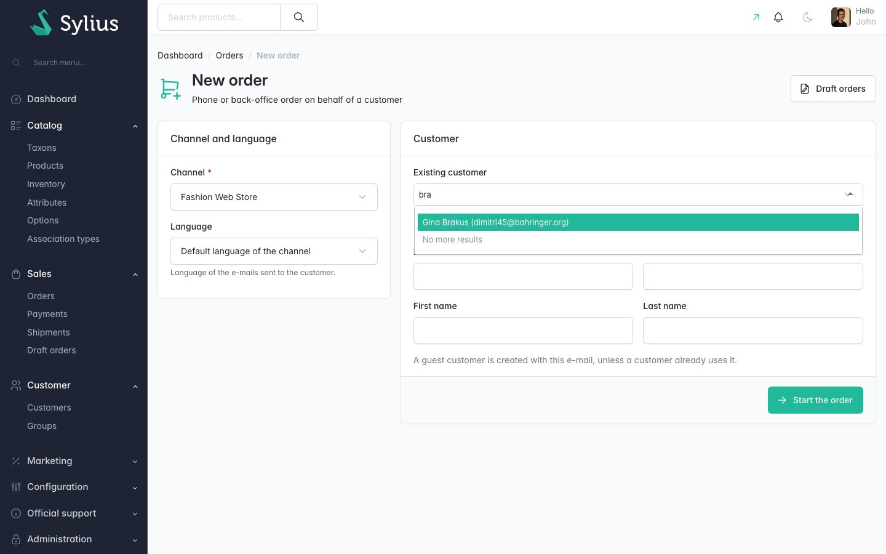
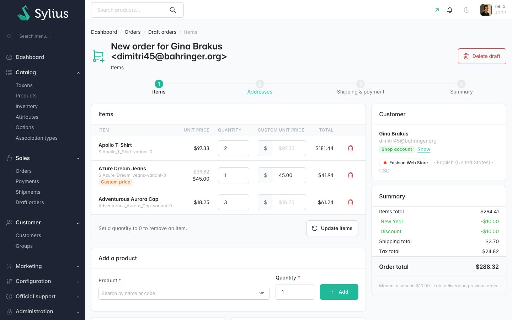
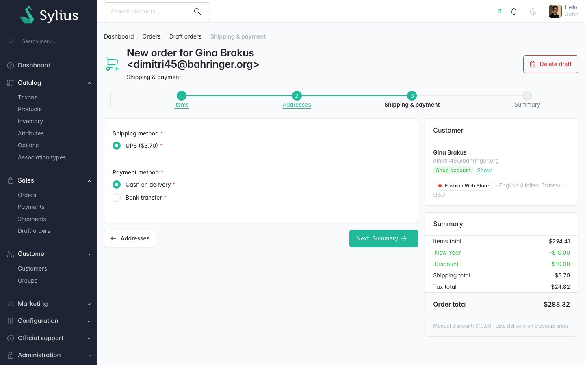
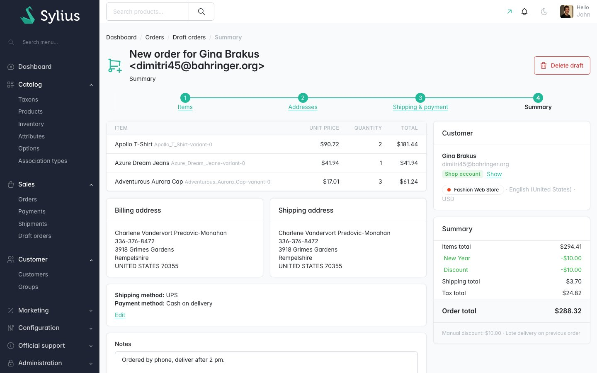
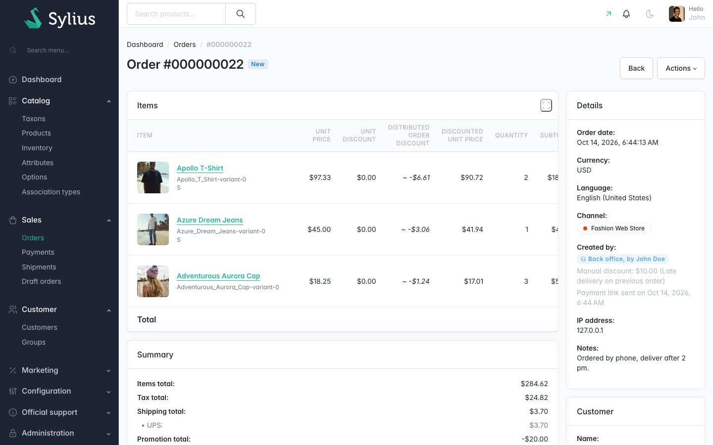

# Sylius Admin Order Creation Plugin

> English: [README.md](README.md) <!-- vitrine:lang -->

[](https://github.com/thibmonier/sylius-admin-order-creation-plugin/actions/workflows/build.yaml)
[](LICENSE)

**Créez des commandes pour le compte de clients (commandes par téléphone et en back-office) depuis l'administration de Sylius 2.**

Sylius 2 ne permet pas de créer une commande en back-office : la section des commandes de
l'administration se contente de lister, d'afficher et d'annuler les commandes passées dans la
boutique. Le `sylius/admin-order-creation-plugin` officiel a été archivé à l'époque de Sylius 1.x.

Ce plugin permet à un administrateur de construire un panier pour un client, étape par étape, et
de le passer par le **même tunnel de commande que la boutique** : même processeur de commande
(prix, promotions, coupons, livraison, taxes), même machine à états du tunnel de commande, même
numéro de commande, même réservation de stock, mêmes états de paiement et de livraison et même
e-mail de confirmation. Gratuit et open source.

## Fonctionnalités

| Besoin | Ce que fait le plugin |
|---|---|
| Prendre une commande par téléphone | Bouton **Créer une commande** sur la liste des commandes et sur la page du client (client présélectionné). Choisissez le canal et la langue, puis un client existant (recherche par e-mail ou par nom) ou un nouveau client invité à partir de son e-mail. |
| Construire le panier | Recherche des produits par nom ou par code (variantes du canal), quantités, totaux en direct recalculés par le processeur de commande de Sylius (promotions de catalogue et de panier, coupon, livraison, taxes). |
| Gestes commerciaux | **Prix unitaire personnalisé** facultatif par article et **remise manuelle sur la commande** avec un motif interne, tous deux protégés par un rôle et désactivables dans la configuration. La remise est répartie sur les unités comme une promotion de commande, si bien que les taxes, les factures, les e-mails et les pages de la boutique la prennent en charge. |
| Adresses | Préremplies avec l'adresse par défaut du client, un clic pour utiliser n'importe quelle adresse du carnet d'adresses, adresse de livraison distincte si nécessaire. |
| Livraison et paiement | Uniquement les modes proposés par les résolveurs du cœur pour la commande (canal, zone, éligibilité), avec les frais de livraison. Les étapes que la boutique ignorerait sont ignorées. |
| Passer la commande | Récapitulatif, validation du tunnel de commande de la boutique (stock, éligibilité), notes, **e-mail de confirmation de commande activé/désactivé**, **e-mail de lien de paiement** facultatif : le client paie depuis la page de commande de la boutique (`/order/{token}`, le flux standard de « nouveau paiement », avec n'importe quelle passerelle de paiement). |
| Commander à nouveau | Action **Commander à nouveau** sur la page de commande : un nouveau brouillon avec les mêmes articles (toujours en vente, aux prix actuels), les mêmes adresses et le même client. |
| Savoir qui a fait quoi | « Créée par : Back-office, par *nom de l'administrateur* » sur la page de commande, ainsi que la commande d'origine d'une nouvelle commande et le motif de la remise manuelle. |
| Brouillons inachevés | Liste des **commandes en préparation** (menu « Sales ») : continuer ou supprimer. Les brouillons ne sont jamais montrés au client comme son panier de la boutique. `tmonier:admin-order:purge-drafts` supprime les brouillons abandonnés. |
| Intégrations | Événement `tmonier_admin_order.order_created` une fois la commande passée. |

Également inclus : traductions en anglais, français, allemand, espagnol, italien, néerlandais et
polonais ; Twig Hooks ; prise en charge de MySQL, MariaDB et PostgreSQL.

## Captures d'écran











## Prérequis

| | Version |
|---|---|
| PHP | 8.2+ |
| Sylius | 2.2, 2.3 |
| Symfony | 6.4, 7.4, 8.0 |

Le tunnel de commande doit utiliser l'adaptateur de machine à états **Symfony Workflow** (celui
par défaut de Sylius 2).

## Installation

1. Ajoutez le paquet :

    ```bash
    composer require tmonier/sylius-admin-order-creation-plugin
    ```

2. Enregistrez le bundle dans `config/bundles.php` (Symfony Flex le fait automatiquement dès
   qu'une recette existe) :

    ```php
    Tmonier\SyliusAdminOrderCreationPlugin\TmonierSyliusAdminOrderCreationPlugin::class => ['all' => true],
    ```

3. Importez la configuration dans `config/packages/tmonier_sylius_admin_order_creation.yaml` :

    ```yaml
    imports:
        - { resource: "@TmonierSyliusAdminOrderCreationPlugin/config/config.yaml" }
    ```

4. Importez les routes de l'administration dans `config/routes/tmonier_sylius_admin_order_creation.yaml` :

    ```yaml
    tmonier_sylius_admin_order_creation:
        resource: "@TmonierSyliusAdminOrderCreationPlugin/config/routes.yaml"
    ```

5. Exécutez les migrations :

    ```bash
    bin/console doctrine:migrations:migrate
    ```

6. Planifiez la purge des brouillons abandonnés (quotidienne, par exemple) :

    ```bash
    bin/console tmonier:admin-order:purge-drafts            # drafts not modified for draft_lifetime_days
    bin/console tmonier:admin-order:purge-drafts --days=3 --dry-run
    ```

## Configuration

```yaml
# config/packages/tmonier_sylius_admin_order_creation.yaml
tmonier_sylius_admin_order_creation:
    allow_price_override: true             # custom unit prices
    allow_manual_discount: true            # order-level manual discount with a reason
    adjustments_role: ROLE_ADMINISTRATION_ACCESS   # role needed for both
    send_confirmation_email_default: true  # default state of the checkbox of the last step
    draft_lifetime_days: 7                 # default of tmonier:admin-order:purge-drafts
    restrict_drafts_to_owner: false        # true: only the author of a draft can open it
```

> **Sécurité :** avec les valeurs par défaut, **tous les administrateurs** peuvent définir des prix
> personnalisés et accorder des remises manuelles, car Sylius CE donne `ROLE_ADMINISTRATION_ACCESS`
> à chaque administrateur. En production, définissez `adjustments_role` sur un rôle qui vous est
> propre (`ROLE_ORDER_DISCOUNTS`...) et ajoutez-le aux `roles` des utilisateurs de l'administration
> autorisés à modifier les prix, ou désactivez ces fonctionnalités.

Le contrôle est assuré par un voter Symfony (`TMONIER_ADMIN_ORDER_PRICE_OVERRIDE`,
`TMONIER_ADMIN_ORDER_MANUAL_DISCOUNT`) que vous pouvez remplacer ou compléter par votre propre
voter. Il est appliqué à la soumission, pas seulement dans les formulaires.

Les brouillons sont partagés par défaut : un administrateur peut commencer une commande et un
autre la terminer. Avec `restrict_drafts_to_owner: true`, seul l'administrateur qui a commencé un
brouillon peut le voir, le modifier et le supprimer (HTTP 403 sinon, et la liste le masque) ; les
brouillons dont l'auteur a été supprimé restent ouverts à tous. Le contrôle est assuré par le voter
`TMONIER_ADMIN_ORDER_DRAFT_ACCESS` (sujet : l'`AdminOrderCreation`) : ajoutez votre propre voter
pour donner accès, par exemple, à un rôle de responsable.

La ressource `AdminOrderCreation` peut être étendue comme n'importe quelle ressource Sylius
(`tmonier_sylius_admin_order_creation.resources.admin_order_creation.classes.model`).

## Fonctionnement

- **Les brouillons sont de vrais paniers.** Le brouillon est une commande Sylius à l'état `cart`,
  créée comme le fait la boutique (canal, devise de base, langue, client, adresse par défaut) et
  repérée par une ligne de la table du plugin `tmonier_admin_order_creation`. Il conserve le
  drapeau « créé par un invité » du cœur, si bien que la boutique ne le reprend jamais comme
  panier du client (la recherche du panier du client ne retient que les paniers créés par le client
  connecté).
- **Chaque modification passe par le processeur de commande du cœur**
  (`sylius.order_processing.order_processor`), exactement comme une modification de panier dans la
  boutique.
- **Les prix personnalisés** définissent le prix unitaire de l'article et marquent l'article comme
  *immutable*, le drapeau du cœur qui indique au recalculateur de prix de le conserver. Le prix du
  catalogue reste visible (barré). Vider le champ rétablit le prix du catalogue.
- **Remise manuelle** : le montant demandé est stocké sous la forme d'un ajustement de commande
  neutre (non compté dans les totaux, libellé fixe) ; le motif interne est stocké uniquement dans
  la table du plugin, jamais sur la commande (l'API de la boutique expose les libellés des
  ajustements). Un processeur de commande du plugin, exécuté après les promotions et avant les
  taxes, la répartit sur les unités sous forme d'ajustements classiques de *promotion de commande*
  libellés « Discount » (code d'origine `tmonier_admin_order_manual_discount`), plafonnés au total
  des articles. Le prix minimum des variantes n'est pas appliqué pour cette décision de
  l'administrateur.
- **Modifier un brouillon après le choix des modes** (articles, prix, coupon, remise) le renvoie à
  l'état « addressed » du tunnel de commande : la livraison et le paiement sont à confirmer de
  nouveau. Les brouillons vides ne peuvent pas être passés.
- **Le passage de la commande** s'exécute dans une transaction qui verrouille la ligne de la
  commande : l'état est relu (un double clic ou une suppression concurrente ne passe ni ne supprime
  jamais deux fois), le coupon et les promotions à limite d'utilisation sont verrouillés et
  rechargés, le brouillon est recalculé avec le contrôle d'intégrité de la boutique
  (`sylius.checker.order.promotions_integrity` et le total) et, si une promotion ne s'applique plus
  ou si le total a changé (promotion expirée, coupon épuisé par d'autres commandes, nouveau prix),
  l'administrateur est renvoyé au récapitulatif avec un avertissement. Un coupon dont la promotion
  ne s'applique plus est retiré de la commande. La page de récapitulatif recalcule aussi le
  brouillon lorsqu'elle est affichée.
- **Produits** : seules les variantes activées de produits activés, vendus dans le canal et avec un
  prix dans ce canal, peuvent être ajoutées (recherche et contrôle côté serveur).
- **Fonctionnalités désactivées** : lorsque `allow_price_override` ou `allow_manual_discount` est
  désactivé, les prix personnalisés ou la remise des brouillons existants sont supprimés à la
  prochaine ouverture du brouillon. Un administrateur sans `adjustments_role` ne peut pas les
  définir, mais peut supprimer ceux accordés par un administrateur autorisé.
- **Brouillons et paniers expirés** : le remover du cœur `sylius:remove-expired-carts` est décoré
  pour laisser les brouillons tranquilles ; `tmonier:admin-order:purge-drafts` gère leur durée de
  vie. La suppression et la purge verrouillent la ligne de la commande et ne suppriment que les
  brouillons encore à l'état cart.
- **Tunnel de commande** : le plugin applique les transitions `sylius_order_checkout` (`address`,
  `select_shipping`, `select_payment`, `complete`) via la machine à états ; les écouteurs de
  workflow du cœur font le reste (recalcul, étapes ignorées, numéro, jeton, réservation de stock,
  utilisation des promotions, création du paiement et de l'expédition, carnet d'adresses du
  client). Avant la finalisation, la commande est validée avec les groupes de la dernière étape de
  la boutique (`sylius`, `sylius_checkout_complete`) : stock, produit, éligibilité des modes de
  livraison et de paiement.
- **E-mails** : l'e-mail de confirmation de commande est envoyé, si demandé, avec l'`OrderEmailManager`
  du cœur (même modèle que la boutique). L'e-mail de lien de paiement
  (`tmonier_admin_order_payment_link`, modèle `@TmonierSyliusAdminOrderCreationPlugin/email/payment_link.html.twig`)
  renvoie vers la page de commande de la boutique du canal de la commande. Un service de messagerie
  défaillant n'empêche jamais de passer la commande : un avertissement est affiché et l'erreur est
  consignée dans les logs.

## Personnalisation

| Hook | Contenu |
|---|---|
| `sylius_admin.order.index.content.header.title_block.actions` → `tmonier_admin_order_create` | Bouton *Créer une commande* |
| `sylius_admin.customer.show.content.header.title_block.actions` → `tmonier_admin_order_create` | *Créer une commande* dans les actions du client |
| `sylius_admin.order.show.content.header.title_block.actions.list` → `tmonier_admin_order_reorder` | Action *Commander à nouveau* |
| `sylius_admin.order.show.content.sections.general` → `tmonier_admin_order_created_by` | « Créée par », origine de la nouvelle commande, remise manuelle |
| `tmonier_admin_order.admin.page` | Mise en page des pages du plugin (début, brouillons, étapes) |

Les modèles peuvent être surchargés dans `templates/bundles/TmonierSyliusAdminOrderCreationPlugin/`.

Écoutez l'événement de création :

```php
#[AsEventListener(event: AdminOrderCreatedEvent::NAME)]
public function onAdminOrderCreated(AdminOrderCreatedEvent $event): void
{
    $order = $event->getOrder();          // placed, flushed, e-mails sent
    $admin = $event->getAdminUser();      // may be null
    $draft = $event->getCreation();       // source order, e-mail flags...
}
```

Les briques de base sont des services : `DraftOrderFactoryInterface`, `DraftOrderModifierInterface`,
`DraftOrderCheckoutInterface`, `ReordererInterface` (pour des imports ou une autre interface).

## Limitations

- Les commandes créées en administration conservent le drapeau « créé par un invité » du cœur (y
  compris pour les clients disposant d'un compte sur la boutique) : la grille des commandes affiche
  l'icône d'invité. La commande figure tout de même dans l'historique du compte du client.
- Ajouter deux fois la même variante fusionne les lignes (comportement du cœur), y compris dans une
  ligne dotée d'un prix personnalisé.
- Le champ province des adresses apparaît après une première soumission pour les pays qui ont des
  provinces (pas de rechargement JavaScript).
- Chaque étape est un rechargement complet de la page (pas de composant dynamique) : les totaux sont
  actualisés après chaque modification.
- Les coupons, les prix personnalisés et les remises manuelles ne sont pas copiés par *Commander à
  nouveau*.
- Le RBAC de Sylius Plus n'est pas intégré : les pages du plugin sont ouvertes à tous les
  administrateurs, seuls les prix personnalisés et les remises dépendent de `adjustments_role` (et
  les brouillons de `restrict_drafts_to_owner`).

## Développement

```bash
cp compose.override.dist.yml compose.override.yml   # publishes MySQL on 3306 (edit the ports if needed)
docker compose up -d mysql mailhog
composer install
(cd vendor/sylius/test-application && yarn install && yarn build)

# The MySQL container has no root password: point both environments at it.
echo 'DATABASE_URL=mysql://root@127.0.0.1:3306/tmonier_sylius_admin_order_creation_%kernel.environment%' > tests/TestApplication/.env.local
cp tests/TestApplication/.env.local tests/TestApplication/.env.test.local

for env in dev test; do
    APP_ENV=$env vendor/bin/console doctrine:database:create --if-not-exists
    APP_ENV=$env vendor/bin/console doctrine:migrations:migrate -n
    APP_ENV=$env vendor/bin/console sylius:fixtures:load -n
done

vendor/bin/phpunit --testsuite unit
vendor/bin/phpunit --testsuite non-unit   # functional + integration, on the test database
vendor/bin/phpstan analyse
vendor/bin/ecs check
```

PHP a besoin de plus de 128 Mo pour compiler le conteneur de l'application de test : faites
précéder les commandes de la console et de PHPStan de `php -d memory_limit=2G` si votre
`memory_limit` est plus bas. Les tests créent le pays, la zone, les modes de livraison et de
paiement et le taux de taxe dont ils ont besoin dans une transaction annulée après chaque test ;
ils ne dépendent donc pas des fixtures aléatoires de Sylius.

<!-- vitrine:demo-b2b:start -->
## Démo B2B

Ce plugin est utilisé dans la [démo B2B Sylius](https://github.com/thibmonier/sylius-b2b-demo) : une boutique Sylius 2.3 avec des données d'exemple fictives, où les plugins B2B fonctionnent ensemble. Le code source, l'installation et les fixtures de la démo sont dans ce dépôt.

La démo est un exemple, pas une configuration de production.
<!-- vitrine:demo-b2b:end -->

## Licence

MIT. Voir [LICENSE](LICENSE).
